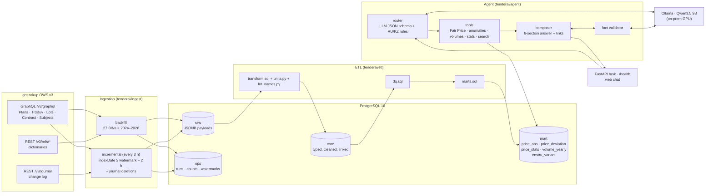

# Architecture

## Components

| Component | Responsibility | Key files |
|---|---|---|
| OWS client | Async httpx: bearer token from env (never logged), semaphore of 4, exponential backoff on timeouts, 429 and 5xx, error detection inside HTTP 200 bodies, GraphQL cursor paging | `tenderai/ows/client.py` |
| Backfill | Per-BIN GraphQL loads; then plan points and announcements referenced from outside the scope; then suppliers. Records API `totalCount` against rows fetched per BIN in `ops.ingest_count` | `tenderai/ingest/backfill.py` |
| Incremental | Re-queries the 27 BINs with `indexDate ≥ watermark − 2 h`, applies journal deletions (latest action wins), refreshes extras, rebuilds core and marts, advances the watermark | `tenderai/ingest/incremental.py` |
| Raw store | Idempotent upserts (`ON CONFLICT … WHERE hash differs`), soft deletes | `tenderai/ingest/store.py` |
| ETL | Rebuilds `core` from `raw` in one transaction (about 1 min): unit normalisation, name cleaning, KATO fallback with provenance, latest-version flags, DQ rules, marts | `tenderai/etl/*` |
| Analytics | Fair Price, price index, robust statistics, volume anomalies (rules + Isolation Forest) | `tenderai/analytics/*` |
| Router | Qwen3.5 fills a JSON schema with thinking off; regexes extract hard facts (BIN, lot number, ENSTRU code, year, %, top-K) and override the LLM; a full rule-based fallback is used if the LLM is unavailable | `tenderai/agent/router.py` |
| Tools | Deterministic SQL and Python over the read-only role. Each returns parameters, method, N, summary, Top-K rows with links, DQ and limitations | `tenderai/agent/tools.py` |
| Composer and validator | Six fixed sections rendered from tool output. The LLM writes only the verdict; every number, BIN and date in it must match the tool facts, otherwise it gets one retry and then the template verdict is used | `tenderai/agent/composer.py`, `validator.py` |
| API and UI | `POST /ask`, `GET /health` (DB, LLM, data lag against the 24 h SLA), static chat page | `tenderai/api/*` |
| Worker | APScheduler running the incremental sync every 3 h; a Kubernetes CronJob is the alternative | `tenderai/worker/scheduler.py` |

## Request flow (`POST /ask`)

1. **Route.** The rules run first: language, BINs, lot number, ENSTRU code, years (in scope and out of scope;
   "2025 compared with 2024" means 2025), threshold, top-K, a unit named in the question ("в пачках"), and the
   direction of a price anomaly ("ниже рынка", "демпинг"). Qwen3.5 then classifies the intent (search / compare /
   analytics / price_anomaly / fair_price / volume_anomaly) and extracts the item and customer names. Hard facts
   from the rules always win; ranking questions ("какой заказчик больше всех…") are comparisons, and a fairness
   intent without a lot number falls back to the rules. Off-topic questions are flagged.
2. **Resolve.** Customer names are split ("A и B", "A; B") and each is matched word by word against the 27
   customers, after collapsing official forms ("Управления делами Президента" → "УДП"); each name yields its single
   best match. **A name that matches nothing is refused, never widened to all 27 customers.** The item text is matched
   to ENSTRU codes in tiers (exact name, name contains the phrase, every word matches, trigram similarity ≥ 0.45).
   Each word must match either the code's name or its plan description (`mart.enstru_variant`), because one product
   is often split into variant codes that differ only there (petrol "марка АИ-92" / "марка АИ-95", diesel "летнее" /
   "зимнее", paper "формат А4" / "формат А3"). A named variant selects its code ("бензин АИ-95"); a bare product name
   selects every variant ("бензин"): spending and anomalies cover all of them, price statistics are shown per
   variant and never pooled. Within a tier, more words in the name win, then more variant words, then the product
   with more purchases across its variants.
3. **Tool.** One deterministic tool call. The LLM performs no arithmetic. Questions outside the warehouse (a year
   before 2024, an unknown customer, an off-topic question, a fairness question without a lot) get a "no data"
   answer that states the reason.
4. **Verdict.** The LLM gets the question and the tool facts as JSON and writes 1–3 sentences. The validator
   parses every number, BIN and date (RU and KZ formats, including "123,7 млн") and matches it to the facts, then
   checks how numbers are used: the compared total may not be presented as the flagged count, and a price outside
   the Q1–Q3 band may not be called inside it. An organisation's number labelled "ИНН" is corrected to "БИН".
   On failure the LLM gets one corrective retry naming the problem, then the template verdict is used.
5. **Render.** Markdown with the six required sections and links to goszakup.gov.kz.

Typical latency on an RTX 5070 Laptop (8 GB) is about 1.5 s for routing, 0.1–2 s for the tool and 2–4 s for the
verdict. The first request after a model unload takes about 45 s.

## Deployment

**Docker Compose** (`deploy/docker-compose.yml`) runs:
- `postgres`
- `ollama` (GPU)
- `migrate` (one-off)
- `api`
- `worker`

All services share one application image (`deploy/Dockerfile`), which runs as a non-root user with no secrets baked in.

**Kubernetes** (`deploy/k8s/`) has:
- Postgres as a StatefulSet with a PVC
- Ollama as a Deployment with a GPU resource request and a PVC for model weights
- the API as a Deployment with readiness on `/health`
- the incremental sync as a CronJob (`0 */3 * * *`) with `concurrencyPolicy: Forbid`
- secrets (`OWS_TOKEN`, DB passwords) in a Kubernetes `Secret`

Fully on-prem: after ingestion, nothing calls outside the cluster except the OWS API (ingest only). The LLM has
no internet access.

## Security

- The OWS token lives only in the environment, a Docker or Kubernetes secret, or a gitignored `.env`.
  It is a `SecretStr` in settings, and the httpx request log is silenced so URLs and headers never reach logs.
- The agent connects with a read-only role restricted to `core` and `mart`, with a 15 s statement timeout. The tools
  build SQL only from fixed templates with bound parameters; the LLM never writes SQL.
- Containers run as non-root, and the image excludes `.env`, data and fixtures (`.dockerignore`).
