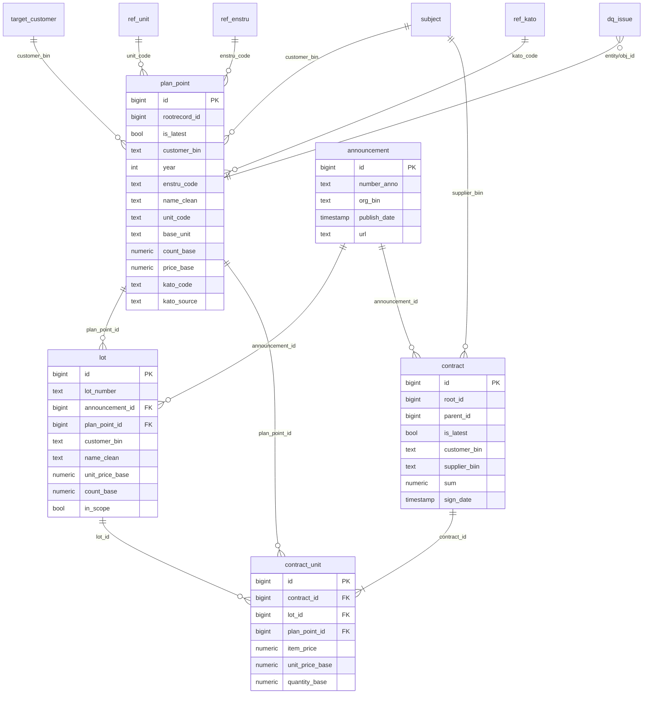

# Storage schema (PostgreSQL 16)

Four schemas, each with one job:

| Schema | Purpose | Written by |
|---|---|---|
| `raw` | Exact API payloads (JSONB), idempotent upserts keyed by `(entity, id)` with an md5 change hash and a soft-delete flag | `tenderai/ingest` |
| `core` | Typed, cleaned, linked entities; rebuilt deterministically from `raw` in one transaction | `tenderai/etl/transform.sql`, `dq.sql` |
| `mart` | Analytical tables the agent reads (prices, deviations, volumes, statistics, DQ summary) | `tenderai/etl/marts.sql` |
| `ops` | Ingestion runs, per-BIN reconciliation (API `totalCount` vs fetched), watermarks | ingest |

Keeping raw payloads means cleaning rules can be changed and core rebuilt (about 1 minute) without calling the API
again. Every number in an answer can be traced back to the payload it came from.

## ER diagram (core)

## Core tables

| Table | Grain | Key columns |
|---|---|---|
| `core.plan_point` | plan point version | `is_latest` (latest per `rootrecord_id`), `enstru_code`, `unit_code` → `base_unit`/`unit_factor`, `count_base`, `price_base`, `kato_code` + `kato_source` |
| `core.announcement` | announcement | `number_anno`, `org_bin`, `publish_date`, `status_id`, `url` |
| `core.lot` | lot | `plan_point_id` (from `pointList[0]`), `unit_price_base`, `in_scope` (plan year or publish year in 2024–2026), `name_clean` |
| `core.contract` | contract version | `is_latest` (not superseded by a child), `sum` (without VAT), `sum_wnds`, `supplier_biin`, `url` |
| `core.contract_unit` | contract line | `item_price` (without VAT), `unit_price_base`, `quantity_base`, `lot_id`, `plan_point_id` |
| `core.subject` | customer or supplier | `biin`, `name_ru`, `kato_code`, `is_target` |
| `core.ref_unit` | МКЕИ unit | `base_unit`, `factor` (from `tenderai/etl/units.py`) |
| `core.ref_kato`, `core.ref_enstru`, `core.ref_status` | dictionaries | |
| `core.cpi` | month × region × category | official CPI levels (December 2020 = 100) and month-on-month change, from stat.gov.kz bulletins |
| `core.dq_issue` | (entity, obj_id, rule) | `severity` error / warning, `detail` JSONB |
| `core.target_customer` | BIN | the assignment's 27 customers |

## Marts

| Mart | Grain | Used by |
|---|---|---|
| `mart.price_obs` | one priced observation (contract line, or a lot without a contract) | all price tools, Fair Price candidates, search |
| `mart.price_stats` | ENSTRU × unit × (all / year) | `price_stats` |
| `mart.price_deviation` | observation + leave-one-out peer weighted average, robust z of log price | `price_anomalies` |
| `mart.volume_yearly` | customer × ENSTRU × unit × year (planned) | `volume_anomalies` |
| `mart.enstru_variant` | ENSTRU code × plan description (variant: "марка АИ-92", "летнее", "формат А4") | item resolution |
| `mart.dq_summary` | entity × rule | confidence blocks, monitoring |

## Access control

- `tenderai` owns everything and is used by ingest and ETL.
- `tenderai_agent` has **read-only** access to `core` and `mart` only (no `raw`, no `ops`), with
  `default_transaction_read_only = on` and `statement_timeout = 15s`. The agent's tools connect as this role.
